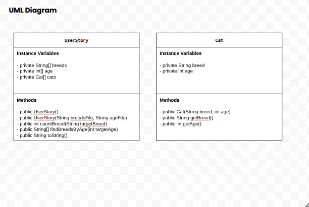

# Unit 2 - Data for Social Good Project

## Introduction

Software engineers develop programs to work with data and provide information to a user. Each user has different needs based on the information they are looking for from data. Your goal is to create a data analysis program for your user that stores and analyzes data to provide the information they need.

## Requirements

Use your knowledge of object-oriented programming, one-dimensional (1D) arrays, and algorithms to create your data analysis program:
- **Write a class** – Write a class to represent your user or business and store and analyze their data with no-argument and parameterized constructors.
- **Create at least two 1D arrays** – Create at least two 1D arrays to store the data that your user needs information about.
- **Write a method** – Write a method that finds or manipulates the elements in a 1D array to provide the information your user needs.
- **Implement a toString() method** – Write a toString() method that returns general information about the data (for example, number of values in the dataset).
- **Document your code** – Use comments to explain the purpose of the methods and code segments and note any preconditions and postconditions.

## User Story 

Include your User Story you analyzed for your project here. Your User Story should have the following format: 

> As a cat enthusiast,   
> I want to analyze cat breed data,   
> so that I can find the best cat breed to adopt.

## Dataset 

Include a hyperlink to the source of your dataset used for this project. Additionally, provide a short description of each column used from the dataset, and the data type. 

Dataset: https://www.kaggle.com/datasets/waqi786/cats-dataset
- **Breeds** (String) - identifies and displays the breed of each cat
- **Age** (int) - displays the age of each cat

## UML Diagram 

Put an image of your UML Diagram here. Upload the image of your UML Diagram to your repository, then use the Markdown syntax to insert your image here. Make sure your image file name is one work, otherwise it might not properly get displayed on this README. 

 

## Description 

My project is a Java program that displays information about different cats using their breeds and ages. The user story focuses on helping somone view and understand cat information from a dataset to figure out which cat breed is the best to adopt. I used two text files, breeds.txt and age.txt, to store the data. The UserStory class uses a parameterized constructor and the FileReader class to read the files into two one-dimensional arrays. I also created a Cat class with instance variables and accessor methods to represent each cat. The program uses for loops and if statements to go through the arrays and analyze the data. The countBreed() method counts cats of a specific breed, while findBreedsByAge() creates a new array of breeds that match a certain age. Finally, the toString() method returns the breed and age of each cat, and the DataRunner class displays the results in the console. This project helps the user easily view cat information without having to look through the original dataset.